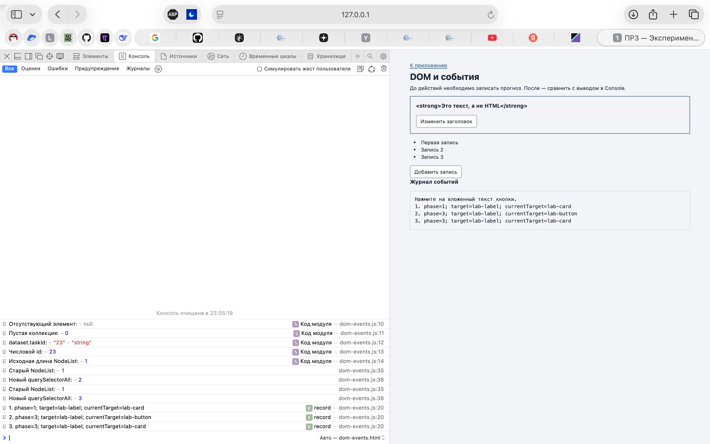
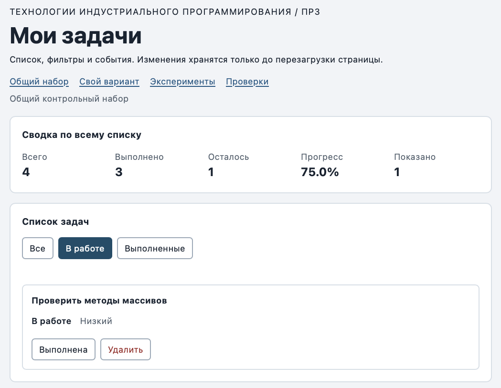

# Практическая работа № 3. Работа с DOM и событиями

## Данные работы

| Поле | Значение |
|---|---|
| Имя | Попков Артём Викторович |
| Группа | ЭФБО-05-25 |
| Вариант из ПР2 | 7 — «Подготовка учебного релиза» |
| Node.js | v24.11.1 |
| Браузер | Safari (macOS) |
| Операционная система | macOS |


## Запуск

Рабочая папка: `practice-03` внутри личного репозитория.

```bash
npm run check:service
npm start
```

Устанавливать зависимости через `npm install` не требуется. Для PowerShell при блокировке `npm.ps1` доступны `npm.cmd` и прямые команды `node`.

```text
http://127.0.0.1:5503/
http://127.0.0.1:5503/index.html?dataset=variant
http://127.0.0.1:5503/examples/dom-events.html
http://127.0.0.1:5503/checks.html
```

Остановка сервера: `Ctrl+C`. Если выбран другой порт, указать фактическую команду и адрес.

## Что перенесено из ПР2

Файлы `src/task-service.js` и `src/data.js` скопированы без изменений из `practice-02/src/`. Повторная проверка `npm run check:service` — 35 из 35 сценариев пройдено (протокол ниже). Исправлений не потребовалось.

## Эксперименты

| № | До запуска: прогноз | После запуска: результат | Объяснение |
|---:|---|---|---|
| 1. Отсутствующий элемент и коллекция | `querySelector` вернёт null, коллекция — длину 0 | `Отсутствующий элемент: null`, `Пустая коллекция: 0` | `querySelector` при отсутствии совпадений возвращает `null` — у него нет свойств, обращение к ним вызовет ошибку. `querySelectorAll` возвращает пустой `NodeList` длины 0, с ним можно работать безопасно. |
| 2. dataset и числовой id | `dataset.taskId` — строка "23", после `Number` — число 23 | `dataset.taskId: 23 string`, `Числовой id: 23` | Атрибуты `data-*` всегда хранятся как строки. Чтобы сравнивать с `id` задачи (число), нужно преобразование `Number()`. |
| 3. Статический NodeList | Сохранённый `initialItems` останется длины 1, новый поиск покажет больше | После двух нажатий: старый NodeList — 1 и 1; новый `querySelectorAll` — 2, затем 3 | `querySelectorAll` возвращает статичный снимок на момент вызова. Новые элементы в старый NodeList не попадают — нужно искать заново. |
| 4. Строка с HTML-разметкой | Заголовок покажет строку с тегами, жирного текста не будет | Заголовок: `<strong>Это текст, а не HTML</strong>` — теги видны как текст; элементов `strong` внутри заголовка: 0 | `textContent` вставляет текст как есть, браузер не разбирает его как HTML. Это защищает от внедрения разметки и скриптов (XSS). |
| 5. Распространение события | Сначала сработает обработчик захвата на карточке, потом кнопка, потом всплытие на карточке | `1. phase=1; target=lab-label; currentTarget=lab-card` → `2. phase=3; target=lab-label; currentTarget=lab-button` → `3. phase=3; target=lab-label; currentTarget=lab-card` | `target` — где реально кликнули (вложенный `span`), `currentTarget` — элемент, на котором висит обработчик. Событие идёт вниз (захват, фаза 1), затем всплывает вверх (фаза 3), поэтому обработчик контейнера получает клик по вложенному элементу — на этом основано делегирование. |

Фактический вывод в консоли Safari (Web Inspector) после двух нажатий «Добавить запись» и нажатия на вложенный текст кнопки:



## Организация кода

| Файл | Что делает |
|---|---|
| `task-service.js` | Функции ПР2: поиск по id, изменение статуса, удаление, сводка `getTaskStats`. Не знает о DOM. |
| `task-selectors.js` | `getVisibleTasks` — отбор задач по фильтру `all` / `pending` / `completed`, возвращает новый массив. |
| `task-view.js` | Создание карточки `createTaskElement`, перерисовка списка `renderTaskList` (через `replaceChildren`), сводка `renderSummary`, пустое состояние `renderEmptyState`. Не меняет данные и не вешает обработчики. |
| `main.js` | Состояние и события: `currentTasks` и `currentFilter`, `renderApp`, обработчики `handleTaskListClick` и `handleFilterClick`. |

- **Полный список** хранится в переменной `currentTasks`, **фильтр** — в `currentFilter` (обе в `main.js`).
- **Событие** обрабатывается делегированием: один обработчик `click` на `ul#task-list`, нужная кнопка находится через `event.target.closest("button[data-action]")`, id — из `data-task-id` карточки, затем `Number` и проверка `Number.isSafeInteger(id) && id > 0`.
- **Сводка** вычисляется функцией ПР2 `getTaskStats(currentTasks)` по всему списку, а не по карточкам на странице; «Показано» — длина отфильтрованной выборки.

## Общий сценарий

Ожидания находятся в разделе 6.5 методички. Ниже записываются фактические результаты запуска.

| Шаг | Видимые id | Всего | Выполнено | Осталось | Прогресс | Показано | Сообщение | Совпало с ожиданием |
|---:|---|---|---|---|---|---|---|---|
| 0 | [1, 4, 7, 10] | 4 | 2 | 2 | 50.0% | 4 | — | да |
| 1 | [4, 7] | 4 | 2 | 2 | 50.0% | 2 | — | да |
| 2 | [7] | 4 | 3 | 1 | 75.0% | 1 | — | да |
| 3 | [1, 4, 7, 10] | 4 | 3 | 1 | 75.0% | 4 | — | да |
| 4 | [1, 4, 10] | 3 | 3 | 0 | 100.0% | 3 | — | да |
| 5 | [] | 3 | 3 | 0 | 100.0% | 0 | «Нет задач по выбранному фильтру.» | да |
| 6 | [1, 4, 10] | 3 | 2 | 1 | 66.7% | 3 | — | да |
| 7 | [] | 0 | 0 | 0 | 0.0% | 0 | «Список задач пуст.» | да |

После перезагрузки страницы восстанавливается исходный набор (шаг 0): данные хранятся только в памяти, сохранение не предусмотрено в ПР3.

## Индивидуальный вариант

Тема варианта 7 — «Подготовка учебного релиза». Исходно все шесть задач выполнены (K = 6): 11 «Собрать список изменений», 23 «Обновить README проекта», 37 «Прогнать все проверки checks.js», 41 «Зафиксировать номер версии», 58 «Проверить работу на чистой копии репозитория», 64 «Опубликовать релиз на GitHub».

| Этап | Всего | Выполнено | Осталось | Прогресс | Видимые id |
|---|---|---|---|---|---|
| До действий | 6 | 6 | 0 | 100.0% | [11, 23, 37, 41, 58, 64] |
| После переключения 23 | 6 | 5 | 1 | 83.3% | [11, 23, 37, 41, 58, 64] |
| После удаления 37 | 5 | 4 | 1 | 80.0% | [11, 23, 41, 58, 64] |
| Итог, фильтр «В работе» | 5 | 4 | 1 | 80.0% | [23] |
| Итог, фильтр «Выполненные» | 5 | 4 | 1 | 80.0% | [11, 41, 58, 64] |

## Протокол проверки сервиса

```text
OK: 01. Создание задачи с явным приоритетом
OK: 02. Приоритет по умолчанию
OK: 03. Удаление краевых пробелов без изменения внутренних
OK: 04. Граничные длины названия и положительный безопасный id
OK: 05. Некорректные названия при создании
OK: 06. Некорректные идентификаторы при создании
OK: 07. Все допустимые приоритеты и отклонение недопустимых
OK: 08. Каждый вызов createTask возвращает новый объект
OK: 09. Поиск по id, а не по индексу
OK: 10. Отсутствующая задача и пустой массив при поиске
OK: 11. Поиск не преобразует строковый id в число
OK: 12. Получение невыполненных задач
OK: 13. Пустой список, все выполнены и все не выполнены
OK: 14. Названия в исходном порядке и пустой список
OK: 15. Сводка по общему набору
OK: 16. Сводка по пустому списку
OK: 17. Сводка: ничего не выполнено и выполнено всё
OK: 18. Процент остаётся числом без предварительного округления
OK: 19. Добавление в конец без изменения входного массива
OK: 20. Добавление в пустой список с приоритетом по умолчанию
OK: 21. Повторяющийся id отклоняется
OK: 22. Добавление не обходит проверки createTask
OK: 23. Изменение completed в обе стороны
OK: 24. completed принимает только boolean
OK: 25. Некорректный или отсутствующий id при изменении статуса
OK: 26. Повторная установка статуса создаёт новый результат
OK: 27. Переименование сохраняет остальные поля
OK: 28. Проверки названия при переименовании
OK: 29. Некорректный или отсутствующий id при переименовании
OK: 30. Удаление по id с сохранением порядка
OK: 31. Удаление единственной записи
OK: 32. Некорректный, отсутствующий id и удаление из пустого списка
OK: 33. Входные объекты не изменяются ни одной операцией
OK: 34. Общий сценарий и все промежуточные сводки
OK: 35. Работа с другим набором, без зависимости от demoTasks

Проверок пройдено: 35; не пройдено: 0.
```

## Протокол браузерных проверок

```text
OK: Фильтр all возвращает новый массив в исходном порядке
OK: Фильтр pending выбирает невыполненные задачи
OK: Фильтр completed выбирает выполненные задачи
OK: Все три фильтра работают с пустым списком
OK: Фильтрация не меняет входные записи и их порядок
OK: Карточка — li.task-card с числовым id в dataset
OK: Статус невыполненной карточки и aria-pressed согласованы
OK: Статус выполненной карточки и aria-pressed согласованы
OK: В карточке две обычные кнопки с вложенными подписями
OK: Все приоритеты отображаются по установленному словарю
OK: Название с разметкой отображается текстом
OK: Отрисовка списка создаёт карточки в исходном порядке
OK: Повторная отрисовка не накапливает карточки
OK: Контейнер списка и его обработчик сохраняются
OK: Отрисовка пустого массива очищает прежние карточки
OK: Сводка считается по всему списку, отдельно выводится Показано
OK: Пустая сводка не содержит NaN и Infinity
OK: Сообщение для полностью пустого списка
OK: Сообщение для пустого результата фильтра
OK: Появление карточек скрывает прежнее пустое состояние
OK: Приложение: начальный набор и сводка
OK: Приложение: фильтр срабатывает по клику на вложенный span
OK: Приложение: активный фильтр отмечен классом и aria-pressed
OK: Приложение: фильтрация не удаляет скрытые задачи
OK: Приложение: переключение по id, а не индексу массива
OK: Приложение: выполненная задача исчезает из фильтра В работе
OK: Приложение: удаление изменяет данные, а не только DOM
OK: Приложение: клик по названию не изменяет данные
OK: Приложение: после перерисовок одно нажатие — одно изменение
OK: Приложение: удаление всех записей и нулевая сводка
OK: Приложение: нет совпадений — не то же самое, что нет задач
OK: Приложение: неизвестный числовой id не меняет данные
OK: Приложение: id 4abc не превращается в 4
OK: Приложение: неизвестное действие игнорируется
OK: Приложение: после изменения сохраняется клавиатурный фокус
OK: Приложение: новая загрузка возвращает исходное состояние
Всего: 36. Пройдено: 36. Ошибок: 0.
```

## Собственные проверки

| № | Исходное состояние и действия | Ожидаемый результат | Фактический результат | Итог |
|---:|---|---|---|---|
| 1 | Свой вариант. Переключить задачу 23 (станет «В работе»), выбрать фильтр «В работе», затем снова переключить 23 | После первого действия в фильтре одна задача [23], прогресс 83.3%; после второго — список пуст с сообщением «Нет задач по выбранному фильтру.», прогресс 100.0% | [23], 83.3% → [], «Нет задач по выбранному фильтру.», 100.0%, всего 6 | Совпало (граничное: все записи одного статуса) |
| 2 | Общий набор. Трижды подряд нажать «Выполнена» у задачи 4 (по вложенной подписи) | Статус меняется три раза: false → true → false → true; одно нажатие — одно изменение | Задача 4 выполнена, `aria-pressed="true"`, выполнено 3, прогресс 75.0%, карточек 4 (не дублируются) | Совпало (событие и повторная отрисовка) |
| 3 | Свой вариант. Удалить все шесть задач по очереди | Всего 0, выполнено 0, осталось 0, прогресс 0.0%, сообщение «Список задач пуст.», без NaN | Всего 0 / 0 / 0, 0.0%, «Список задач пуст.» | Совпало (граничное: пустой список) |

Минимум один случай — граничное состояние, один — событие или повторная отрисовка.

## Отладка и клавиатура

Точка останова — строка `const rawId = card.dataset.taskId;` в `handleTaskListClick` (`src/main.js`). Нажатие «Выполнена» у задачи 4 по вложенной подписи:

| Значение | Результат |
|---|---|
| `event.target` | `span.action-label` (вложенная подпись) |
| `event.currentTarget` | `ul#task-list` (контейнер с делегированным обработчиком) |
| `dataset.taskId` | `"4"`, тип `string` |
| числовой `id` | `4`, тип `number` |
| действие | `toggle` |
| найденная запись | `{ id: 4, title: "Подготовить модель задач", completed: false, priority: "high" }` |
| результат сервиса | `{ ok: true, tasks: [...] }`, у задачи 4 `completed: true`, исходный массив не изменён |

**Клавиатура.** Tab переводит фокус по фильтрам и кнопкам карточек. Enter и Space на кнопке «Выполнена» у задачи 4 переключают статус (выполнено 2 → 3 → 2). После изменения статуса фокус остаётся на кнопке «Выполнена» той же задачи (функция `restoreTaskFocus`). После удаления карточки фокус переходит на активный фильтр «Все».

**Отказы.** В панели Elements атрибут `data-task-id` карточки задачи 7 изменён на `777`: после нажатия — сообщение «Задача с id 777 не найдена.», данные не изменились (всего 4, выполнено 2, 50.0%). Атрибут карточки задачи 4 изменён на `4abc`: сообщение «Некорректный идентификатор задачи: «4abc».», данные не изменились — `Number("4abc")` даёт `NaN`, проверка `Number.isSafeInteger` отклоняет значение. Выбор фильтра перерисовывает карточки из настоящего массива и очищает сообщение.

## Вид приложения



## Дополнительное задание

Дополнительное задание не выполнялось.

## Вывод

Подключён браузерный интерфейс к функциям ПР2: отображение карточек, изменение статуса, удаление, три фильтра, сводка и пустые состояния. Проверки сервиса — 35 из 35, браузерные — 36 из 36, общий сценарий и вариант 7 совпали с ожиданиями. Данные (`currentTasks`) меняются только через функции ПР2, а DOM всегда перерисовывается из массива функцией `renderApp`: удаление элемента со страницы без изменения массива не удалило бы задачу — после перерисовки она вернулась бы. Обработчики назначены один раз на контейнеры (делегирование), поэтому повторная отрисовка не создаёт лишних подписок.
